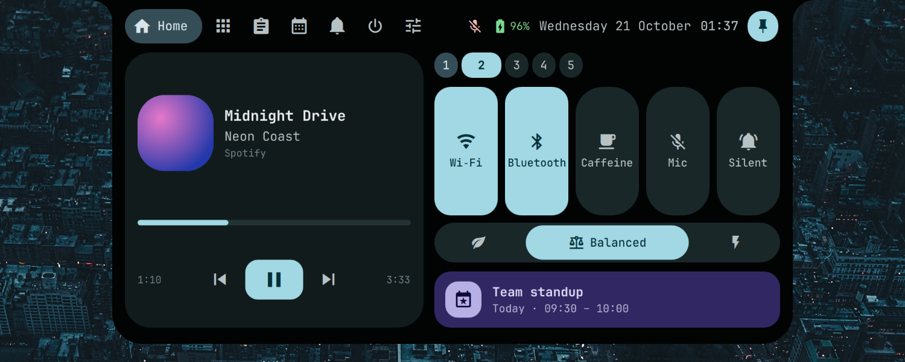
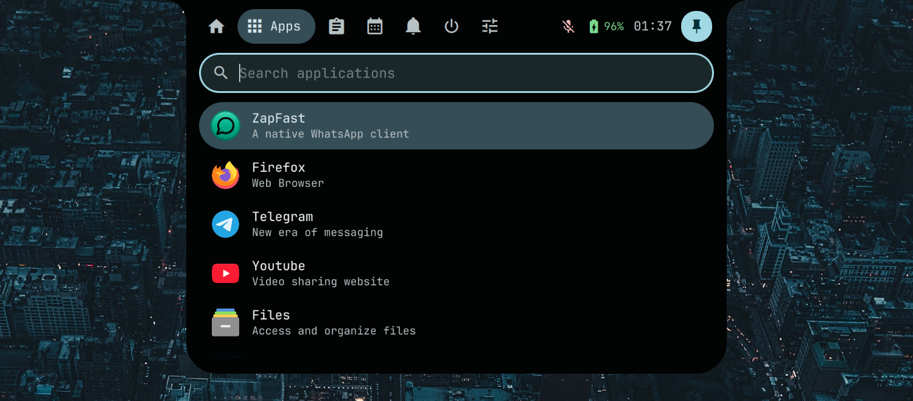
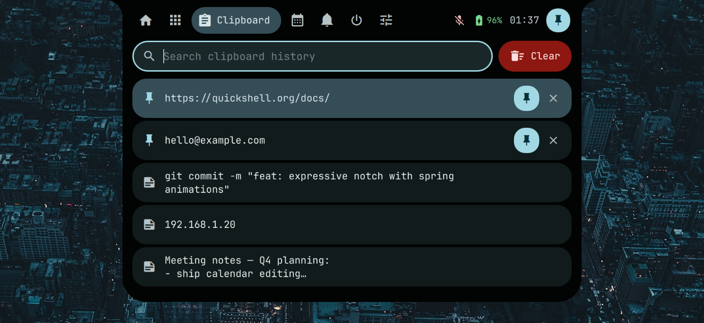
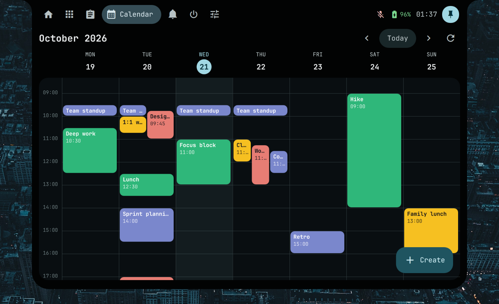
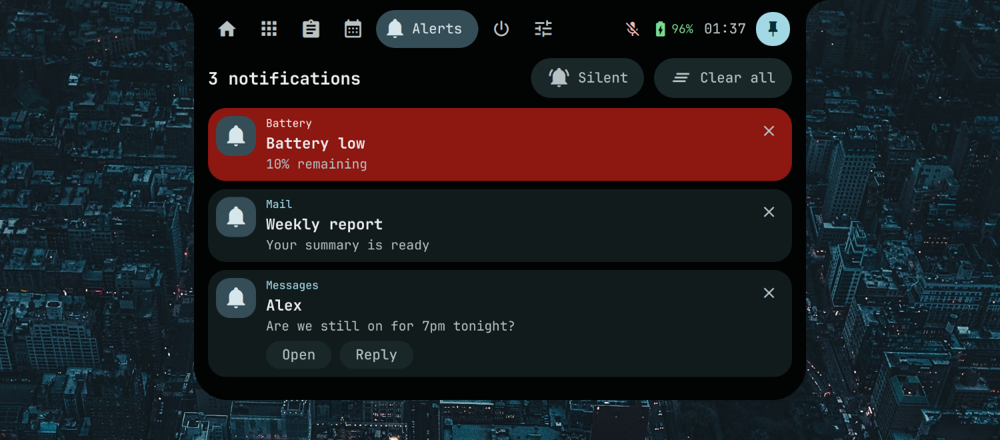
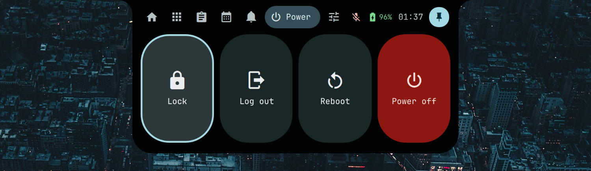
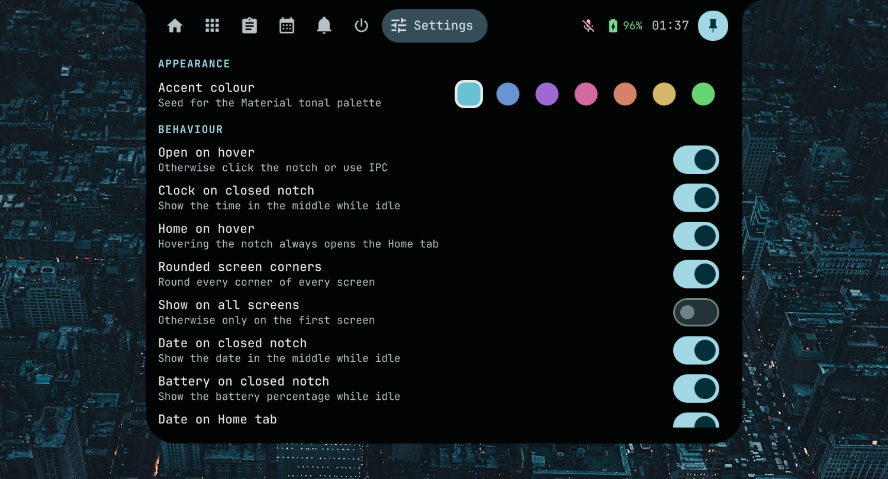

# quickshell-notch

A [Boring Notch](https://github.com/TheBoredTeam/boring.notch)-style island for Hyprland, written in [Quickshell](https://quickshell.org). It sits at the top of the screen, shows live activity while idle, and expands into a small control centre. Styled after Material 3 Expressive: shape-morphing buttons, spring animations, tonal colours generated from one accent hue, JetBrainsMono Nerd Font text and its Material Design Icons glyphs.



## Contents
- [Install and run](#install-and-run)
- [Tour](#tour)
- [Everything it does](#everything-it-does)
- [Settings](#settings)
- [Google Calendar setup](#google-calendar-setup)
- [Keybinds and IPC](#keybinds-and-ipc)
- [Project layout](#project-layout)

## Install and run
Requirements: Quickshell 0.3+, Hyprland, PipeWire, UPower, power-profiles-daemon, NetworkManager, BlueZ, `brightnessctl`, `clipse` + `wl-clipboard`, `systemd` (for caffeine and power actions), `hyprlock`, Python 3, and the JetBrainsMono Nerd Font.

Run: `./run.sh` (or `quickshell $(pwd)`).
Only one notification daemon can run: stop other shells/daemons (mako, dunst, your old quickshell config) first.

## Tour

### Idle notch
The closed notch is a small pill that shows live information: the active Hyprland workspace (the chip bounces when you switch), album art and an equaliser while music plays, an optional clock, and indicators for caffeine, muted microphone, do-not-disturb, unread notifications and battery.


### Home
Media player with seek bar, workspace switcher, quick toggles (Wi-Fi, Bluetooth, Caffeine, Mic, Silent), power profile switch, system tray icons, and your next calendar event.


### Apps
Application launcher: type to search, arrows to move, Enter to launch. Apps you launch often rise to the top.



### Clipboard
Clipboard history from clipse, with search, pinning and deletion.



### Calendar
Google Calendar week view in the style of Google Calendar: overlapping events share the width of the day. Create, edit and delete events.



### Notifications
Incoming notifications slide out of the notch with their action buttons, then stay in the Alerts tab until dismissed.




### Power


### Settings


### On-screen messages
Caffeine, microphone, volume and brightness changes show in the notch. The caffeine and microphone texts are yours to customise.


## Everything it does

**Notch behaviour**
- Opens when you hover it, when you click it, or through IPC and keybinds. Closes when the pointer leaves, unless pinned. The pin button in the header keeps it open; Escape or a click outside closes a pinned notch.
- "Home on hover": hovering always opens the Home tab (default on). Keybinds and IPC open the tab you asked for.
- Autohide: the idle notch slides off the top edge; hover the top edge to bring it back. Notifications and on-screen messages still appear.
- Optional clock, date and battery percentage on the closed notch (each its own setting). The battery icon is green while charging, accent-coloured when full, red when low.
- Multi-monitor: show on one screen (the first, or the one named by `screenName`) or on all screens. With several notches, hover opens only the one you hovered, and keybinds open the one on the focused monitor.
- Rounded screen corners on every screen (click-through overlay, adjustable radius).
- Springy open/close animation, with concave "ears" at the top corners like a hardware notch.

**Home tab**
- Media player (any MPRIS player, for example Spotify or a browser): album art with rounded corners that squares up when paused, title, artist, seek bar, previous, play/pause, next.
- Hyprland workspaces: shows the existing ones, highlights the active one as a wide pill, click to switch.
- Quick toggles that morph shape when switched on: Wi-Fi, Bluetooth, Caffeine, Mic, Silent (do not disturb).
- Power profile for power-profiles-daemon as one segmented control: Saver, Balanced, Performance (Performance only if the hardware offers it).
- Optional date next to the clock in the header (Settings → Date on Home tab).
- System tray (StatusNotifier): left click activates, middle click triggers the secondary action, right click opens the app's menu inside the notch, including submenus.
- Next event card from Google Calendar; click it to open the Calendar tab.

**Apps tab**
- Searches desktop entries by name, then generic name, comment and keywords, with fuzzy matching.
- Ranks by how often you launch each app. Closes after launching.

**Clipboard tab**
- Reads clipse's history file (`~/.config/clipse/clipboard_history.json`), so anything clipse records appears here, text and images.
- Search, click or Enter to copy back with `wl-copy`, pin entries (pinned ones stay on top), delete one entry (button or Delete key), clear everything unpinned.
- Starts `clipse -listen` if no clipse process is running.

**Calendar tab**
- Week view with day headers, an all-day row, an hourly grid, a "now" line, and today highlighted. Previous / next week, Today and refresh buttons. Refreshes every 10 minutes.
- Overlapping events are laid out in side-by-side lanes. Events use their Google calendar colour.
- Click an event for details (time, location, calendar).
- Manage events: the **Create** button in the bottom right corner, or click an empty slot to create an event at that hour. Edit and delete from the event card. The editor has title, calendar, all-day, start and end, location, and validates dates and times.
- Sign in and out of Google, with a clear message if setup is missing.

**Notifications**
- Acts as the notification daemon. New notifications slide out of the notch with icon or image, app name, summary, body and action buttons. Critical ones stay longer. The peek stays while the pointer is on it.
- Two quick dismissals on the peek: the eye-off button hides it but keeps it in the Alerts tab; the bin button dismisses it completely.
- Alerts tab: history list with actions, per-item dismiss, Clear all, Silent toggle. A badge on the tab and a counter on the closed notch show unread ones.
- Silent mode keeps notifications but stops them from appearing.

**On-screen messages**
- Caffeine (inhibits idle and sleep through `systemd-inhibit`) and microphone mute show a message with a custom text you set.
- The microphone message also appears when the mute is changed elsewhere, for example by a hardware key.
- Volume and brightness show a slider with the percentage. They react to changes made by anything: PipeWire for volume, a udev monitor for brightness, so existing `wpctl` and `brightnessctl` keybinds just work.

**Power tab**
- Lock (hyprlock), log out, reboot, power off. Everything except Lock needs a second press or tap within three seconds.
- Keyboard: Left/Right (or Tab) to move, Enter or Space to activate, 1 to 4 to jump straight to an action.

## Settings
Open the Settings tab. Everything is saved to `~/.config/quickshell-notch/settings.json`.

| Setting | What it does |
| --- | --- |
| Accent colour | Seed hue for the whole palette |
| Open on hover | Hover opens the notch; otherwise click or IPC |
| Home on hover | Hover always opens Home (default on) |
| Rounded screen corners | Round every screen corner |
| Show on all screens | One notch per screen |
| Clock on closed notch | Time in the middle of the idle notch |
| Date on closed notch | Date in the middle of the idle notch |
| Battery on closed notch | Battery percentage on the idle notch |
| Date on Home tab | Date next to the clock in the header |
| Autohide | Slide the idle notch off screen |
| Do not disturb | Keep notifications, do not show them |
| Notification time | How long a notification stays out |
| 24-hour clock | Clock and calendar time format |
| Week starts on Monday | Calendar week layout |
| Custom messages | Texts for caffeine on/off and mic live/muted |
| Google Calendar | Sign in / sign out |

Only in `settings.json`: `screenName` (which screen to use when not showing on all) and `cornerRadius` (screen corner size, default 20).

## Google Calendar setup
Uses `scripts/gcal.py` (Python standard library only, OAuth with PKCE on a local loopback port).
1. In Google Cloud Console, enable the Google Calendar API and create an OAuth client of type **Desktop app**.
2. Save the downloaded JSON as `~/.config/quickshell-notch/gcal/client.json` or `~/.config/quickshell/gcal/client.json`.
3. Open the Calendar tab and press **Sign in with Google**. The token is stored in `~/.local/share/quickshell-island/gcal-token.json` (mode 600).

Editing needs the calendar.events scope. If the tab asks you to sign in again, an older read-only token was found.

## Keybinds and IPC
```
bind = SUPER, Space,  exec, qs ipc call notch launcher
bind = SUPER, V,      exec, qs ipc call notch clipboard
bind = SUPER, C,      exec, qs ipc call notch calendar
bind = SUPER, N,      exec, qs ipc call notch notifications
bind = SUPER, Escape, exec, qs ipc call notch power
bind = , XF86AudioMicMute, exec, qs ipc call notch mic
```
All calls go to the `notch` target:

| Call | Effect |
| --- | --- |
| `toggle`, `close` | Open (Home) or close |
| `open <tab>` | `home`, `apps`, `clipboard`, `calendar`, `notifications`, `power`, `settings` |
| `launcher`, `clipboard`, `calendar`, `notifications`, `power` | Toggle that tab |
| `caffeine`, `mic`, `dnd` | Toggle caffeine, microphone mute, do not disturb |
| `volumeUp`, `volumeDown`, `volumeMute` | Change volume (5% steps) and show the slider |
| `brightnessUp`, `brightnessDown` | Change brightness (5% steps) and show the slider |

Opened this way the notch stays until you press Escape, click outside, or toggle it again.

## Project layout
- `shell.qml`: entry point, creates the notches, screen corners and IPC handler.
- `config/`: `Settings` (persisted settings), `Theme` (colours, shapes, motion), `Glyphs` (icon name to Nerd Font code point).
- `services/`: singletons for the notch state, notifications, media, audio, brightness, battery, caffeine, mic, clipboard (clipse), apps, Google Calendar, power actions and on-screen messages.
- `components/`: reusable widgets (buttons, switches, text fields, icons, rounded images, media card, workspace row, quick toggles, tray, event editor...).
- `modules/notch/`: the notch window, its shape, idle/peek/message content and the tabs.
- `modules/corner/`: rounded screen corners.
- `scripts/gcal.py`: Google Calendar client.
- `docs/screenshots/`: images used above.
