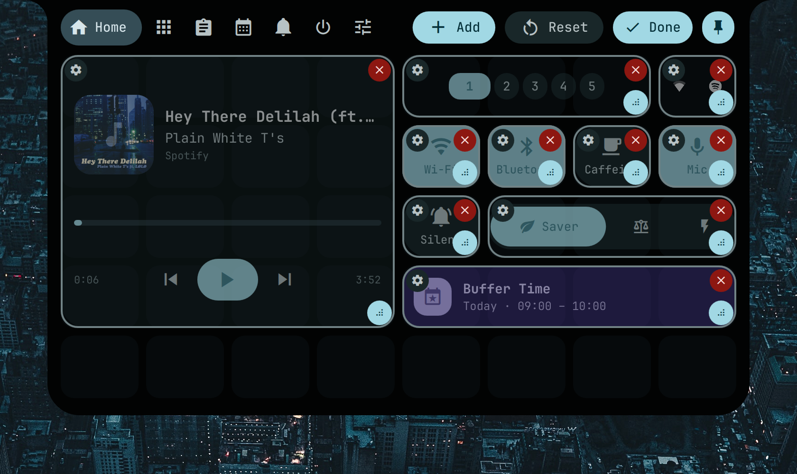
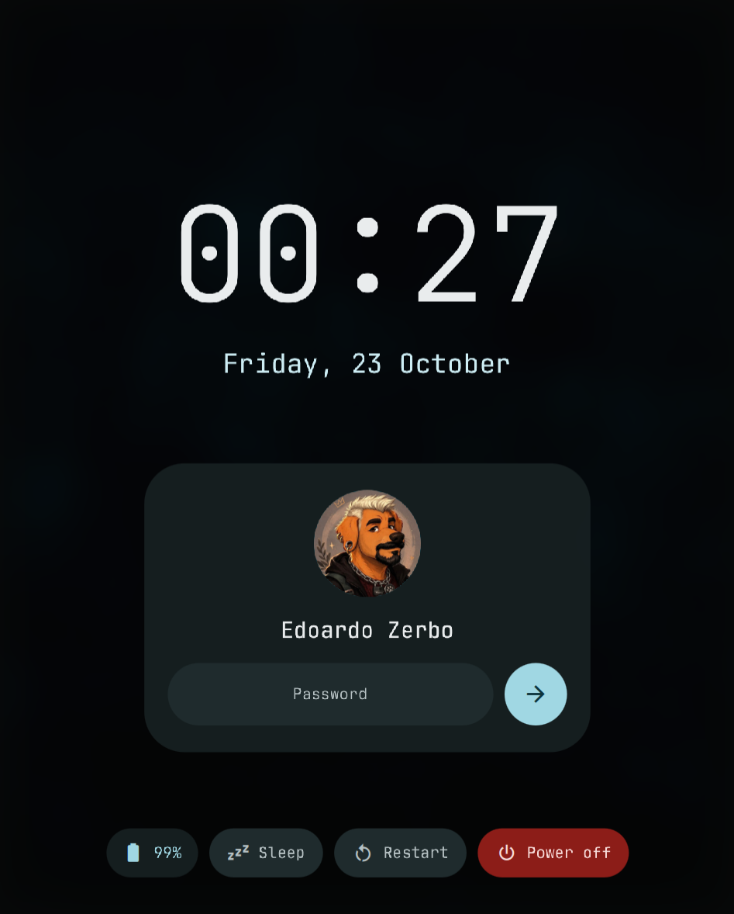
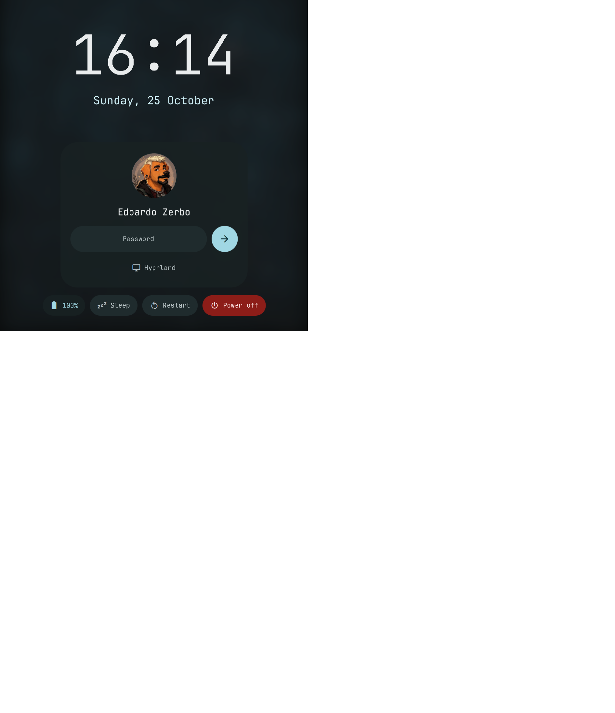

# quickshell-notch

A [Boring Notch](https://github.com/TheBoredTeam/boring.notch)-style island for Hyprland, written in [Quickshell](https://quickshell.org). It sits at the top of the screen, shows live activity while idle, and expands into a small control centre. Styled after Material 3 Expressive: shape-morphing buttons, spring animations, tonal colours generated from one accent hue, JetBrainsMono Nerd Font text and its Material Design Icons glyphs.


## Contents
- [Install and run](#install-and-run)
- [Tour](#tour)
- [Everything it does](#everything-it-does)
- [Settings](#settings)
- [Google Calendar setup](#google-calendar-setup)
- [Lock screen](#lock-screen)
- [Login screen (greetd)](#login-screen-greetd)
- [Keybinds and IPC](#keybinds-and-ipc)
- [Project layout](#project-layout)

The reasoning behind the look and behaviour is in [DESIGN.md](DESIGN.md).

## Install and run
Requirements: Quickshell 0.3+, Hyprland, PipeWire, UPower, power-profiles-daemon, NetworkManager, BlueZ, `brightnessctl`, `clipse` + `wl-clipboard`, `systemd` (for caffeine and power actions), `hyprlock`, Python 3, and the JetBrainsMono Nerd Font.

Run: `./run.sh` (or `quickshell $(pwd)`).
Only one notification daemon can run: stop other shells/daemons (mako, dunst, your old quickshell config) first.

## Tour

### Idle notch
The closed notch is a small pill that shows live information: the active Hyprland workspace (the chip bounces when you switch), album art and an equaliser while music plays, an optional clock, and indicators for caffeine, muted microphone, do-not-disturb, unread notifications and battery.


### Home
Media player with seek bar, workspace switcher, quick toggles (Wi-Fi, Bluetooth, Caffeine, Mic, Silent), power profile switch, system tray icons, and your next calendar event.


Edit mode: move, resize, configure or remove widgets, add new ones.



### Apps
Application launcher: type to search, arrows to move, Enter to launch. Apps you launch often rise to the top.


### Clipboard
Clipboard history from clipse, with search, pinning and deletion.


### Calendar
Google Calendar week view in the style of Google Calendar: overlapping events share the width of the day. Create, edit and delete events.


### Notifications
Incoming notifications slide out of the notch with their action buttons, then stay in the Alerts tab until dismissed.


### Power


### Settings


### On-screen messages
Caffeine, microphone, volume and brightness changes show in the notch. The caffeine and microphone texts are yours to customise.


## Everything it does

**Notch behaviour**
- Opens when you hover it, when you click it, or through IPC and keybinds. Closes when the pointer leaves, unless pinned. The pin button in the header keeps it open; Escape or a click outside closes a pinned notch.
- "Home on hover": hovering always opens the Home tab (default on). Keybinds and IPC open the tab you asked for.
- Autohide: the idle notch slides off the top edge; hover the top edge to bring it back. Notifications and on-screen messages still appear.
- Optional clock, date and battery percentage on the closed notch (each its own setting). The battery icon is green while charging, accent-coloured when full, red when low.
- Multi-monitor: show on one screen (the first, or the one named by `screenName`) or on all screens. With several notches, hover opens only the one you hovered, and keybinds open the one on the focused monitor.
- Rounded screen corners on every screen (click-through overlay, adjustable radius).
- Springy open/close animation, with concave "ears" at the top corners like a hardware notch.

**Home tab (customisable)**
- The Home dashboard is a grid of widgets. Press the pencil in the header to edit: drag a widget to move it, drag its corner handle to resize it, use the gear to configure it or the cross to remove it. Dropping onto an occupied spot: hold still for a moment and the widget underneath swaps places with yours (when it fits) or the others shuffle aside to the nearest free space; the preview turns green when it works and stays red when it can't. **Add** opens the widget catalogue and **Reset** restores the default layout. The layout is saved in `settings.json`.
- Widgets: media player, workspaces, system tray, quick toggle (Wi-Fi, Bluetooth, caffeine, mic, do not disturb; pick which and its label), power profile, next event, clock (time, seconds, date, date format), battery, volume or brightness slider, note, command button, command output, and your own QML file.
- Custom widgets: a **command button** runs a shell command (choose icon and label); **command output** shows a command's output, refreshed every N seconds, with an optional click command; **QML file** loads any file from `~/.config/quickshell-notch/widgets/` (see `docs/examples/Hello.qml`).
- Home tab contents (previous fixed layout, now the default):
- Media player (any MPRIS player, for example Spotify or a browser): album art with rounded corners that squares up when paused, title, artist, seek bar, previous, play/pause, next.
- Hyprland workspaces: shows the existing ones, highlights the active one as a wide pill, click to switch.
- Quick toggles that morph shape when switched on: Wi-Fi, Bluetooth, Caffeine, Mic, Silent (do not disturb).
- Power profile for power-profiles-daemon as one segmented control: Saver, Balanced, Performance (Performance only if the hardware offers it).
- Optional date next to the clock in the header (Settings → Date on Home tab).
- System tray (StatusNotifier): left click activates, middle click triggers the secondary action, right click opens the app's menu inside the notch, including submenus.
- Next event card from Google Calendar; click it to open the Calendar tab.

**Apps tab**
- Searches desktop entries by name, then generic name, comment and keywords, with fuzzy matching.
- Ranks by how often you launch each app. Closes after launching.

**Clipboard tab**
- Reads clipse's history file (`~/.config/clipse/clipboard_history.json`), so anything clipse records appears here, text and images.
- Search, click or Enter to copy back with `wl-copy`, pin entries (pinned ones stay on top), delete one entry (button or Delete key), clear everything unpinned.
- Starts `clipse -listen` if no clipse process is running.

**Calendar tab**
- Week view with day headers, an all-day row, an hourly grid, a "now" line, and today highlighted. Previous / next week, Today and refresh buttons. Refreshes every 10 minutes.
- Overlapping events are laid out in side-by-side lanes. Events use their Google calendar colour.
- Click an event for details (time, location, calendar).
- Manage events: the **Create** button in the bottom right corner, or click an empty slot to create an event at that hour. Edit and delete from the event card. The editor has title, calendar, all-day, start and end, location, and validates dates and times.
- Sign in and out of Google, with a clear message if setup is missing.

**Notifications**
- Acts as the notification daemon. New notifications slide out of the notch with icon or image, app name, summary, body and action buttons. Critical ones stay longer. The peek stays while the pointer is on it.
- Two quick dismissals on the peek: the eye-off button hides it but keeps it in the Alerts tab; the bin button dismisses it completely.
- Alerts tab: history list with actions, per-item dismiss, Clear all, Silent toggle. A badge on the tab and a counter on the closed notch show unread ones.
- Silent mode keeps notifications but stops them from appearing.

**On-screen messages**
- Caffeine (inhibits idle and sleep through `systemd-inhibit`) and microphone mute show a message with a custom text you set.
- The microphone message also appears when the mute is changed elsewhere, for example by a hardware key.
- Volume and brightness show a slider with the percentage. They react to changes made by anything: PipeWire for volume, a udev monitor for brightness, so existing `wpctl` and `brightnessctl` keybinds just work.

**Power tab**
- Lock (the built-in lock screen, or hyprlock if you turn that off), log out, reboot, power off. Everything except Lock needs a second press or tap within three seconds.
- Keyboard: Left/Right (or Tab) to move, Enter or Space to activate, 1 to 4 to jump straight to an action.

## Settings
Open the Settings tab. Everything is saved to `~/.config/quickshell-notch/settings.json`.

| Setting | What it does |
| --- | --- |
| Accent colour | Seed hue for the whole palette |
| Open on hover | Hover opens the notch; otherwise click or IPC |
| Home on hover | Hover always opens Home (default on) |
| Rounded screen corners | Round every screen corner |
| Show on all screens | One notch per screen |
| Clock on closed notch | Time in the middle of the idle notch |
| Date on closed notch | Date in the middle of the idle notch |
| Battery on closed notch | Battery percentage on the idle notch |
| Date on Home tab | Date next to the clock in the header |
| Autohide | Slide the idle notch off screen |
| Do not disturb | Keep notifications, do not show them |
| Notification time | How long a notification stays out |
| 24-hour clock | Clock and calendar time format |
| Week starts on Monday | Calendar week layout |
| Custom messages | Texts for caffeine on/off and mic live/muted |
| Built-in lock screen | Lock button uses the built-in lock screen instead of hyprlock |
| Google Calendar | Sign in / sign out |

Only in `settings.json`: `lockWallpaper` and `lockAvatar` (image paths for the lock screen), `lockPam` (PAM service, default `hyprlock`), `lockPamDir` (folder with your own PAM service file), `screenName` (which screen to use when not showing on all) and `cornerRadius` (screen corner size, default 20).

## Google Calendar setup
Uses `scripts/gcal.py` (Python standard library only, OAuth with PKCE on a local loopback port).
1. In Google Cloud Console, enable the Google Calendar API and create an OAuth client of type **Desktop app**.
2. Save the downloaded JSON as `~/.config/quickshell-notch/gcal/client.json` or `~/.config/quickshell/gcal/client.json`.
3. Open the Calendar tab and press **Sign in with Google**. The token is stored in `~/.local/share/quickshell-island/gcal-token.json` (mode 600).

Editing needs the calendar.events scope. If the tab asks you to sign in again, an older read-only token was found.

## Lock screen
The notch includes an Expressive Material lock screen (`modules/lock/`) that replaces hyprlock. It uses the Wayland session-lock protocol, so the compositor shows nothing else until you authenticate, and it checks the password through PAM. It shows a blurred wallpaper, a big clock, your avatar and name, a password field with animated dots (wrong passwords shake the card), and Sleep, Restart and Power off buttons. Typing works straight away; Enter or the arrow unlocks, Escape or Ctrl+Backspace clears the field. It follows your accent colour and appears on every screen.



### Moving from hyprlock
1. **Quickshell must be running before you lock**, because the lock lives inside it. If it is not running, `qs ipc call notch lock` fails and nothing locks.
2. **Safety net.** If Quickshell crashes while locked, Hyprland stays locked and shows its "lockscreen died" screen. Add this to your Hyprland config so that starting Quickshell again (from a TTY: `quickshell -p <this folder>`) can take over the lock and let you in:
   - `hyprland.conf`: `misc { allow_session_lock_restore = true }`
   - Lua config: `misc = { allow_session_lock_restore = true }`

   Without it, the recovery is the command Hyprland prints on that screen: from a TTY, `hyprctl --instance 0 eval 'hl.clear_crashed_lockscreen()'`.
3. **Check the PAM service.** Passwords are checked with the PAM service named in `lockPam` (default `hyprlock`, which exists while hyprlock is installed or enabled, for example `programs.hyprlock.enable = true` on NixOS). If you remove hyprlock, set `lockPam` to another service in `/etc/pam.d` (`login`, `system-auth`, `swaylock`), or put your own file in a folder and point `lockPamDir` at it, with `lockPam` set to the file name. A service that does not exist makes unlocking fail with "Authentication service ... is not usable", so test it first.
4. **Set the images** (optional) in `~/.config/quickshell-notch/settings.json`: `"lockWallpaper": "/home/you/.config/hypr/assets/wallpaper.png"` and `"lockAvatar": "/home/you/.config/hypr/assets/profile.jpg"`. Without them you get a plain background and the first letter of your name.
5. **Point the triggers at it.**
   - A keybind that ran `hyprlock`: `bind = SUPER, L, exec, qs ipc call notch lock`. In a Lua config: `bind(SHIFT .. " + M", run("qs ipc call notch lock"))`.
   - hypridle: change `lock_cmd = pidof hyprlock || hyprlock` to `lock_cmd = qs ipc call notch lock`. Keep `before_sleep_cmd = loginctl lock-session` and `on-timeout = loginctl lock-session`; they call `lock_cmd`. Locking twice is harmless.
   - The Power tab's Lock button uses the built-in screen by default. Turn off Settings → Built-in lock screen to go back to hyprlock.
6. **Try it** with `qs ipc call notch lock` while you can still reach a TTY, and check that your password unlocks it before you rely on it.

Limits: password only (no fingerprint or other PAM prompts), no keyboard layout or caps-lock indicator, no notifications on the lock screen.

## Login screen (greetd)
`greeter.qml` is the same Expressive Material look as a login screen for [greetd](https://sr.ht/~kennylevinsen/greetd/): blurred wallpaper, clock, the user's avatar and name, a password field, a session picker (Hyprland, or any session with a `.desktop` file in `wayland-sessions`), a user picker when there is more than one user, and Sleep, Restart and Power off. It remembers the last user and session. Wrong passwords shake the card and show greetd's message; extra PAM questions (a one-time code) appear as a new prompt.



How it runs: greetd starts a small Wayland compositor as the `greeter` user, the compositor starts `quickshell -p greeter.qml`, and when you log in the greeter hands over to your session and the compositor exits. The compositor must support layer-shell: Hyprland (used below), sway or niri work; `cage` does not. Everything the greeter reads must be readable by the `greeter` user, so the repo cannot stay in your home folder.

Settings live in `/etc/quickshell-notch/greeter.json` (or the file named by `$QS_GREETER_CONFIG`); all keys are optional:

| Key | Meaning |
| --- | --- |
| `wallpaper` | Background image, readable by `greeter` |
| `hue` | Accent hue, 0 to 1 (same as Accent colour in Settings) |
| `user` | User selected when nothing is remembered |
| `session` | Session name selected when nothing is remembered |
| `sessions` | `[{ "name": "Hyprland", "command": "start-hyprland" }]`, to skip scanning `wayland-sessions` |
| `avatars` | `{ "alice": "/etc/quickshell-notch/alice.png" }`; otherwise `/var/lib/AccountsService/icons/<user>`, then the first letter of the name |
| `use24h` | 24-hour clock |
| `env` | Environment for the session, default `["XDG_SESSION_TYPE=wayland"]` |

### Set it up (any distribution)
Needs `greetd`, Hyprland, Quickshell 0.3+ and the JetBrainsMono Nerd Font installed system-wide (the greeter user cannot see fonts in your home folder).
1. **Keep a way back.** Know how to reach a TTY (Ctrl+Alt+F3) and how to switch back to your old display manager (`sudo systemctl enable --now sddm`). Do not restart greetd from inside your session while testing: it ends the session.
2. **Copy the repo and settings** where the greeter can read them:
   ```
   sudo mkdir -p /etc/quickshell-notch
   sudo cp -r . /etc/quickshell-notch/
   sudo cp greeter/greeter.json /etc/quickshell-notch/greeter.json
   sudo cp ~/Pictures/wallpaper.png /etc/quickshell-notch/wallpaper.png
   sudo install -d -o greeter -g greeter /var/cache/quickshell-notch
   ```
   Edit `/etc/quickshell-notch/greeter.json` (wallpaper path, hue, user).
3. **Point greetd at it.** Use `/etc/quickshell-notch/greeter/hyprland.lua` if your Hyprland uses a Lua config (0.55+), or `hyprland.conf` otherwise (that format is removed in 0.57). In `/etc/greetd/config.toml`:
   ```
   [terminal]
   vt = 1

   [default_session]
   command = "start-hyprland -- --config /etc/quickshell-notch/greeter/hyprland.lua"
   user = "greeter"
   ```
   If your Hyprland has no `start-hyprland`, use `Hyprland --config <file>`. The `greeter` user must exist (`sudo useradd -M -G video greeter` if the package did not create it).
4. **Switch display manager and reboot.**
   ```
   sudo systemctl disable sddm      # or gdm, lightdm...
   sudo systemctl enable greetd
   sudo reboot
   ```
5. **If the screen stays black**, press Ctrl+Alt+F3, log in, and read `journalctl -u greetd -b`. Re-enable your old display manager with `sudo systemctl disable greetd && sudo systemctl enable sddm`.

To update later, copy the repo again (`sudo cp -r . /etc/quickshell-notch/`).

### Set it up (NixOS, with the flake)
The repo is a flake that exports the greeter as a NixOS module, so you reference it from your own flake and nothing is copied by hand. The module copies the repo, the wallpaper and the avatar into the Nix store (readable by the `greeter` user), installs greetd with a Hyprland greeter session, writes `greeter.json`, creates the cache folder and installs the font.
1. **Make the files visible to Nix.** Flakes only see files tracked by git, so in this repo run `git add flake.nix assets greeter greeter.qml services components` (and commit). `assets/wallpaper.png` and `assets/profile.png` are the default background and avatar.
2. **Add the repo as an input** in your `flake.nix` and import the module:
   ```nix
   {
     inputs.nixpkgs.url = "github:NixOS/nixpkgs/nixos-unstable";
     # a local checkout; a git URL such as github:you/quickshell-notch works too
     inputs.quickshell-notch.url = "git+file:///home/alice/Sources/PERSONAL/quickshell-notch";
     inputs.quickshell-notch.inputs.nixpkgs.follows = "nixpkgs";   # optional

     outputs = { nixpkgs, quickshell-notch, ... }: {
       nixosConfigurations.myhost = nixpkgs.lib.nixosSystem {
         system = "x86_64-linux";
         modules = [
           ./configuration.nix
           quickshell-notch.nixosModules.greeter
           ({ ... }: {
             services.quickshellNotchGreeter = {
               enable = true;
               user = "alice";                                              # first selected user
               avatars.alice = quickshell-notch + "/assets/profile.png";    # picture shown for alice
               # wallpaper defaults to assets/wallpaper.png of the repo; override with any path:
               # wallpaper = ./wallpaper.png;
               # hue = 0.53;
             };
             services.displayManager.sddm.enable = false;   # or gdm / lightdm: only one display manager
           })
         ];
       };
     };
   }
   ```
   There is no `$HOME` in Nix: paths are real paths (`./file`, `inputs.x + "/file"`), never strings like `"$HOME/..."`.
3. **Update the input and build for the next boot** (switching does not restart a running display manager, and a login screen is safest to try from the boot menu):
   ```
   nix flake update quickshell-notch
   sudo nixos-rebuild boot --flake .#myhost
   sudo reboot
   ```
4. If something is wrong, pick the previous generation in the boot menu. That brings back your old login screen.

Module options: `enable`, `src` (the repo, default is the flake itself), `wallpaper` (default `assets/wallpaper.png`), `avatars` (`{ user = path; }`), `hue`, `user`, `session`.

Without the flake: `imports = [ /path/to/quickshell-notch/greeter/nixos.nix ];` works the same, with `src` pointing at the repo.

**Login goes back to the login screen?** Your session started and exited at once. The greeter starts it through a login shell (so it gets the full `PATH`) and writes everything it prints to `~/.cache/quickshell-notch-session.log`; read that file from a TTY, and `journalctl -b -u greetd` for greetd's side. Messages like `Failed to create /var/empty/.cache for shader cache` come from the greeter itself (its user has no home folder) and are harmless.

Limits: password only (no fingerprint prompts as a first step), no on-screen keyboard, and the user picker lists accounts with a UID of 1000 to 59999 and a real shell.

## Keybinds and IPC
```
bind = SUPER, Space,  exec, qs ipc call notch launcher
bind = SUPER, V,      exec, qs ipc call notch clipboard
bind = SUPER, C,      exec, qs ipc call notch calendar
bind = SUPER, N,      exec, qs ipc call notch notifications
bind = SUPER, Escape, exec, qs ipc call notch power
bind = , XF86AudioMicMute, exec, qs ipc call notch mic
```
All calls go to the `notch` target:

| Call | Effect |
| --- | --- |
| `toggle`, `close` | Open (Home) or close |
| `open <tab>` | `home`, `apps`, `clipboard`, `calendar`, `notifications`, `power`, `settings` |
| `launcher`, `clipboard`, `calendar`, `notifications`, `power` | Toggle that tab |
| `lock` | Lock the session with the built-in lock screen |
| `homeEdit` | Open Home and toggle edit mode |
| `caffeine`, `mic`, `dnd` | Toggle caffeine, microphone mute, do not disturb |
| `volumeUp`, `volumeDown`, `volumeMute` | Change volume (5% steps) and show the slider |
| `brightnessUp`, `brightnessDown` | Change brightness (5% steps) and show the slider |

Opened this way the notch stays until you press Escape, click outside, or toggle it again.

## Project layout
- `shell.qml`: entry point, creates the notches, screen corners and IPC handler.
- `config/`: `Settings` (persisted settings), `Theme` (colours, shapes, motion), `Glyphs` (icon name to Nerd Font code point).
- `flake.nix`: exports the login screen as a NixOS module (`nixosModules.greeter`).
- `greeter.qml`, `services/GreeterCtl.qml`, `greeter/`: the greetd login screen, its state and its example configs (Hyprland Lua and classic, greetd, NixOS module).
- `components/AuthScreen.qml`: the card, clock and password field shared by the lock screen and the login screen.
- `modules/lock/`: the lock screen (`LockScreen` session lock, `LockSurface` per-screen UI); `services/LockCtl` holds its state and the PAM conversation.
- `services/`: singletons for the notch state, notifications, media, audio, brightness, battery, caffeine, mic, clipboard (clipse), apps, Google Calendar, power actions and on-screen messages.
- `components/`: reusable widgets (buttons, switches, text fields, icons, rounded images, media card, workspace row, quick toggles, tray, event editor...).
- `modules/notch/`: the notch window, its shape, idle/peek/message content and the tabs.
- `modules/corner/`: rounded screen corners.
- `scripts/gcal.py`: Google Calendar client.
- `docs/screenshots/`: images used above.
